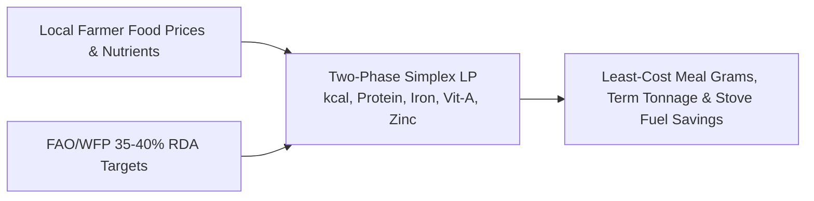

# schoolmeal-opt

[](https://github.com/codesphere-u/schoolmeal-opt/actions/workflows/ci.yml)
[](LICENSE)
[](pyproject.toml)
[](pyproject.toml)

**Zero-dependency Home-Grown School Feeding (HGSF) optimizer: FAO/WFP 30-40% RDA nutrition verifier (kcal, protein, iron, vitamin A, zinc), Two-Phase Simplex LP least-cost local meal planner, and smallholder procurement tonnage.**

- **Mission Domain:** Education, Child Nutrition & Food Security
- **Stack:** Pure Python 3.11+ (zero runtime third-party dependencies, `mypy --strict`, `ruff`, `pytest`)
- **Maintainer:** Codesphere Innovations (U) Limited (`codesphere-u`)

---

## Problem Solved

Schools serving maize-and-beans-only lunches frequently miss critical Vitamin A, iron, and zinc thresholds for learning outcomes while overpaying on ad-hoc procurement instead of optimizing local biofortified crops.

## Key Features

- Self-contained pure-Python Two-Phase Simplex LP solver (`_solve_simplex_min`) with Bland's anti-cycling rule requiring zero external math packages.
- East African local HGSF food basket (fortified posho, NARO high-iron beans, orange-fleshed sweet potato, dried mukene fish, groundnut paste, amaranth greens, fortified oil) solving exact least-cost meals meeting 35–40% child RDA (`optimize_school_meal`).
- Term-level smallholder cooperative procurement tonnage and institutional rocket-stove firewood savings calculator.

## Architecture Overview



See [docs/architecture.md](docs/architecture.md) for module-level design details.

## Installation

```bash
git clone https://github.com/codesphere-u/schoolmeal-opt.git
cd schoolmeal-opt
uv sync --extra dev
```

Or install in editable mode with standard `pip`:

```bash
pip install -e ".[dev]"
```

## Quick Start (CLI)

```bash
schoolmeal-opt --students 650 --days 65
```

## Quick Start (Python API)

```python
from schoolmeal_opt import optimize_school_meal

plan = optimize_school_meal(students=800, school_days=65)
assert plan.feasible and plan.kcal_per_meal >= 700 and plan.vit_a_ug_per_meal >= 200
```

## Testing & Quality Gates

```bash
uv run ruff check src tests
uv run mypy src
uv run pytest -v
```

## Security, Contributing & Roadmap

- **Security:** See [SECURITY.md](SECURITY.md) for responsible disclosure procedures.
- **Contributing:** See [CONTRIBUTING.md](CONTRIBUTING.md) and [CODE_OF_CONDUCT.md](CODE_OF_CONDUCT.md).
- **Changelog & Roadmap:** See [CHANGELOG.md](CHANGELOG.md) and [ROADMAP.md](ROADMAP.md).

## License

MIT License — see [LICENSE](LICENSE).

## Support & Contact

Open an issue on [GitHub Issues](https://github.com/codesphere-u/schoolmeal-opt/issues) or contact `codesphereinnovationz@gmail.com`.
